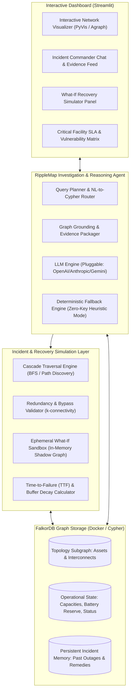
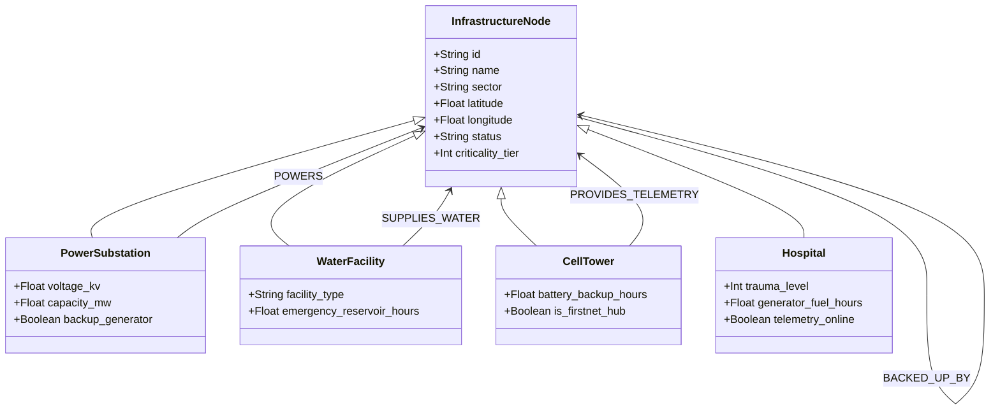
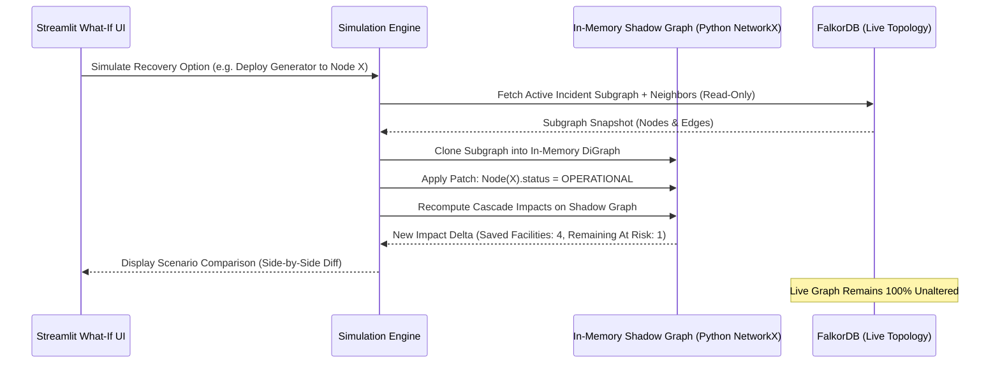
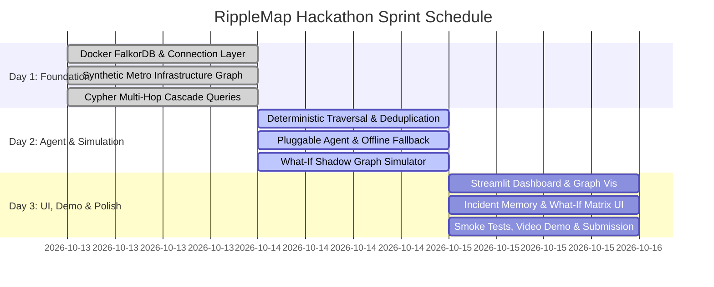

# RippleMap — The Hidden Consequence Agent
## Hackathon Architecture & Implementation Blueprint
**Hackathon:** Graph Hacks: Context for AI Agents (WeMakeDevs & FalkorDB)  
**Track:** Agents That Act on Connected Data  
**Target Environment:** Python 3.11+, Docker Desktop, FalkorDB, Node.js 18+, Modern Web Browser  
**Workspace:** `RippleMap` (Repository Root)

---

## Executive Summary & Core Philosophy

When a high-voltage substation floods or a primary water main bursts, emergency dispatchers and grid managers rarely see the invisible second-, third-, and fourth-order dependencies: cell towers losing backup battery after 4 hours, sewer lift stations backing up, refrigerated pharmaceutical depots spoiling, and hospital trauma centers diverting ambulances due to telemetry loss.

**RippleMap** bridges this gap. It does not treat an LLM as a hallucinating oracle; rather, **FalkorDB acts as the deterministic context engine and source of ground truth**. The agent:
1. Translates natural language incident reports into structured graph traversal queries.
2. Traverses directed dependency chains, redundant bypass paths, capacity thresholds, and time-to-failure buffers.
3. Formulates graph-grounded remediation strategies where **every claim cites exact Cypher paths, node IDs, and verified operational state**.

---

## 1. System Architecture Diagram



### Component Breakdown
1. **FalkorDB Container Layer**: Local Redis-compatible FalkorDB engine deployed via Docker (`falkordb/falkordb:latest`), exposing Cypher via standard Python clients (`falkordb-py`).
2. **Deterministic Context Engine**: Pure algorithmic Cypher queries compute exact reachability, multi-hop impacts, and topological cut sets.
3. **Dual-Mode Agent (Pluggable LLM + Deterministic Fallback)**:
   - *Online Mode*: Formats Cypher query result sets as factual graph context for the LLM to generate narrative incident briefings, operational risk trade-offs, and remediation rationale.
   - *Deterministic Offline Mode*: A rule-based synthesis engine producing identical structured evidence tables, severity rankings, and action plans without requiring an API key or internet access.
4. **Isolated What-If Sandbox**: Evaluates recovery options without mutating production topology.

---

## 2. FalkorDB Graph Schema

### 2.1 Node Labels & Properties

| Label | Description | Primary Key | Key Properties |
|---|---|---|---|
| `:InfrastructureNode` *(Base)* | Common interface for all city assets | `id` | `id: STRING`, `name: STRING`, `sector: STRING`, `latitude: FLOAT`, `longitude: FLOAT`, `status: STRING` (`OPERATIONAL`, `DEGRADED`, `FAILED`, `OFFLINE`), `criticality_tier: INT` (1-4) |
| `:PowerSubstation` | Electric transmission & distribution nodes | `id` | `voltage_kv: FLOAT`, `capacity_mw: FLOAT`, `current_load_mw: FLOAT`, `backup_generator: BOOLEAN` |
| `:WaterFacility` | Treatment plants, pump stations, water mains | `id` | `facility_type: STRING`, `pressure_psi: FLOAT`, `emergency_reservoir_hours: FLOAT` |
| `:CellTower` | Cellular and emergency radio masts | `id` | `coverage_radius_km: FLOAT`, `battery_backup_hours: FLOAT`, `is_firstnet_hub: BOOLEAN` |
| `:Hospital` | Healthcare facilities & trauma centers | `id` | `trauma_level: INT`, `bed_count: INT`, `icu_capacity: INT`, `generator_fuel_hours: FLOAT`, `telemetry_online: BOOLEAN` |
| `:TransitHub` | Rail stations, traffic control hubs, bridges | `id` | `daily_commuters: INT`, `signals_powered: BOOLEAN`, `evacuation_route: BOOLEAN` |
| `:Incident` | Historical or active incident records | `id` | `id: STRING`, `timestamp: STRING`, `root_cause_node_id: STRING`, `affected_count: INT`, `resolved: BOOLEAN` |

### 2.2 Relationship Types & Properties

| Relationship | Direction | Semantics | Key Properties |
|---|---|---|---|
| `:POWERS` | `(:PowerSubstation) -> (:InfrastructureNode)` | Electrical grid transmission/feed | `feed_priority: INT`, `is_primary: BOOLEAN`, `line_capacity_mw: FLOAT`, `status: STRING` (`ACTIVE`, `TRIPPED`) |
| `:SUPPLIES_WATER` | `(:WaterFacility) -> (:InfrastructureNode)` | Potable or cooling water delivery | `flow_rate_gpm: FLOAT`, `is_cooling_loop: BOOLEAN` |
| `:PROVIDES_TELEMETRY` | `(:CellTower) -> (:InfrastructureNode)` | SCADA, ambulance dispatch, remote monitoring | `bandwidth_mbps: FLOAT`, `latency_ms: INT`, `is_primary_scada: BOOLEAN` |
| `:DISPATCHES_EMERGENCY` | `(:Hospital) -> (:TransitHub)` | Critical transit corridor access | `route_congestion_factor: FLOAT`, `distance_km: FLOAT` |
| `:BACKED_UP_BY` | `(:InfrastructureNode) -> (:InfrastructureNode)` | Redundant secondary failover | `switchover_time_sec: INT`, `auto_failover: BOOLEAN` |
| `:CAUSED_BY` | `(:Incident) -> (:InfrastructureNode)` | Provenance tracking for incident memory | `severity: STRING`, `recorded_at: STRING` |



---

## 3. Cypher Query Patterns for Multi-Hop Impact Analysis

### 3.1 Initial Cascade Reachability (1 to 4 Hops)
Find all directly and indirectly connected facilities downstream from an initial point of failure:

```cypher
MATCH path = (root:InfrastructureNode {id: $failed_node_id})-[r:POWERS|SUPPLIES_WATER|PROVIDES_TELEMETRY*1..4]->(downstream:InfrastructureNode)
WHERE NONE(n IN nodes(path)[1..-1] WHERE n.status = 'OFFLINE')
RETURN 
    downstream.id AS impacted_id,
    downstream.name AS impacted_name,
    downstream.sector AS sector,
    downstream.criticality_tier AS tier,
    length(path) AS hop_distance,
    [rel IN relationships(path) | type(rel)] AS dependency_chain,
    [n IN nodes(path) | n.name] AS traversal_path
ORDER BY tier ASC, hop_distance ASC
```

### 3.2 Redundancy Verification (Active Bypass Check)
A downstream node is **not** truly failed if it possesses an active alternate feeder or backup generator that does not pass through the failed root:

```cypher
MATCH (target:InfrastructureNode {id: $impacted_id})
OPTIONAL MATCH (target)<-[alt:POWERS]-(alt_power:PowerSubstation)
WHERE alt_power.id <> $failed_node_id AND alt_power.status = 'OPERATIONAL'
OPTIONAL MATCH (target)-[:BACKED_UP_BY]->(backup:InfrastructureNode)
WHERE backup.status = 'OPERATIONAL'
RETURN 
    target.id AS target_id,
    target.name AS target_name,
    COUNT(alt_power) AS active_alternate_power_feeds,
    COLLECT(alt_power.name) AS alternate_feed_names,
    COUNT(backup) AS active_backup_assets,
    CASE 
        WHEN COUNT(alt_power) > 0 OR COUNT(backup) > 0 THEN 'PROTECTED_BY_REDUNDANCY'
        ELSE 'CRITICAL_FAILURE'
    END AS operational_impact_assessment
```

### 3.3 Time-to-Failure (Buffer Decay) Estimation
Calculate which facilities have temporary buffer reserves (battery, fuel, emergency reservoir water) before catastrophic failure:

```cypher
MATCH path = (root:InfrastructureNode {id: $failed_node_id})-[r:POWERS*1..3]->(target:InfrastructureNode)
WHERE target:Hospital OR target:CellTower OR target:WaterFacility
RETURN 
    target.id AS asset_id,
    target.name AS asset_name,
    labels(target)[0] AS facility_type,
    target.criticality_tier AS tier,
    CASE 
        WHEN target:Hospital THEN target.generator_fuel_hours
        WHEN target:CellTower THEN target.battery_backup_hours
        WHEN target:WaterFacility THEN target.emergency_reservoir_hours
        ELSE 0.0
    END AS estimated_buffer_hours,
    length(path) AS cascade_depth
ORDER BY estimated_buffer_hours ASC
```

---

## 4. Cycle Handling & Impact Deduplication Logic

Graph dependencies in municipal systems frequently contain cycles (e.g., Substation A powers Pump Station B; Pump Station B provides cooling water to Substation A; or dual ring distribution).

### 4.1 FalkorDB Cypher Cycle Protection
- Cypher relationship uniqueness prevents traversing the exact same relationship edge twice within a single path.
- Node uniqueness constraints are explicitly enforced in queries using node-deduplication aggregation:

```cypher
MATCH path = (root:InfrastructureNode {id: $root_id})-[r:POWERS|SUPPLIES_WATER*1..4]->(impacted:InfrastructureNode)
WITH impacted, min(length(path)) AS shortest_hop, collect(path)[0] AS shortest_path
RETURN 
    impacted.id AS asset_id,
    impacted.name AS asset_name,
    shortest_hop AS hops,
    [n IN nodes(shortest_path) | n.id] AS proof_path
ORDER BY hops ASC
```

### 4.2 Python Cascade Traversal Engine (`cascade_engine.py`)
To ensure safety and exact determinism, the traversal engine runs a BFS-based algorithm with cycle prevention and topological state tracking:

```python
# Algorithmic structure for Cascade Traversal
def calculate_cascade(root_id: str, failed_nodes: set[str], client) -> dict:
    visited = set()
    impacts = {}
    queue = [(root_id, 0, [root_id])]
    visited.add(root_id)
    
    while queue:
        curr_id, hop, path = queue.pop(0)
        if hop >= 4:
            continue
            
        downstream = client.get_active_dependents(curr_id)
        for neighbor, rel_type in downstream:
            if neighbor.id in visited:
                continue
                
            has_redundancy = client.check_alternate_feeds(neighbor.id, failed_nodes)
            if not has_redundancy:
                visited.add(neighbor.id)
                impacts[neighbor.id] = {
                    "hop": hop + 1,
                    "cause_path": path + [neighbor.id],
                    "status": "CASCADE_FAILURE",
                    "buffer_hours": neighbor.buffer_time
                }
                queue.append((neighbor.id, hop + 1, path + [neighbor.id]))
            else:
                impacts[neighbor.id] = {
                    "hop": hop + 1,
                    "cause_path": path + [neighbor.id],
                    "status": "DEGRADED_FAILOVER",
                    "buffer_hours": neighbor.buffer_time
                }
    return impacts
```

---

## 5. Ephemeral "What-If" Recovery Simulation Architecture

### 5.1 The Isolation Dilemma
In operational incident management, testing remediation actions (e.g., "What happens if we re-route Substation 3 to Feeder Ring B?" or "Deploy mobile generator to Saint Jude Hospital") must **never corrupt the live incident graph** or cause state leaks between scenarios.

### 5.2 Isolated Sandbox Design Pattern



### 5.3 Comparison Metrics
When comparing Scenario A (Mobile Generator Deployment) vs Scenario B (Substation Feeder Bypass Switch), the simulator outputs a **Deterministic Scorecard**:
1. **Critical Facilities Restored**: Count of Tier 1 & Tier 2 facilities restored to operational status.
2. **Hop Reduction Delta**: Number of cascading failure paths pruned.
3. **Time to Execute vs Buffer Margin**: Does the action complete before hospital generator fuel runs out?
4. **Graph Provenance Proof**: Exact node IDs restored and remaining failure paths.

---

## 6. Streamlit Interface & 3-Minute Hackathon Demo Narrative

### 6.1 Dashboard Layout Architecture

```
+-----------------------------------------------------------------------------------------+
|  RIPPLEMAP: The Hidden Consequence Agent                      [ Status: Connected (FalkorDB) ] |
+-----------------------------------------------------------------------------------------+
| [ Left Sidebar: Incident Control ] | [ Center: Interactive Graph View ] | [ Right: Evidence & What-If ] |
| - Select Scenario:                | - PyVis / Agraph Topology View     | - Critical Facilities at Risk|
|   * Grid Flooding (Metro Central) | - Live Color Code:                 |   * St. Jude Hospital (3.2h) |
|   * Fiber Cut (Telecom Spine)     |     Red: Root Failure              |   * Central Water Station #2 |
|   * Custom Node Injector          |     Orange: Cascade Impact         | - Agent Investigation Feed:  |
| - Filter by Sector (Power/Water)  |     Green: Operational             |   "Substation 4 outage cuts  |
| - Max Traversal Hops: [ 1..4 ]    |     Dashed: Alternate Bypass       |    power to Tower 9. Tower 9 |
| - LLM Mode: [ Pluggable / No-Key ]| - Click Node to inspect properties |    cuts telemetry to ICU..." |
+-----------------------------------------------------------------------------------------+
| [ Bottom Panel: Side-by-Side What-If Scenario Matrix ]                                   |
| Baseline Impact: 12 facilities down | Option 1 (Deploy Generator): 4 saved | Option 2 (Grid Switch): 9 saved |
+-----------------------------------------------------------------------------------------+
```

### 6.2 The Three-Minute Demo Story (Winning Narrative)

* **Minute 0:00 - 0:45 | The Illusion of Isolation**
  - *Action*: Select scenario: *"Substation North 4 - Flood Inundation"*.
  - *Observation*: Standard SCADA says only 1 electric node is damaged.
  - *The Reveal*: Run RippleMap. The graph visualizer ripples outward in 3 waves. Substation North 4 trips Water Pump Station 2, which starves cooling water to Telecom Hub West, cutting telemetry to Metro Hospital Trauma Center.
  - *Punchline*: *"Without a knowledge graph, Metro Hospital doesn't know its remote telemetry will die until alarms sound in the ICU."*

* **Minute 0:45 - 1:45 | Grounded Graph Investigation (No Hallucinations)**
  - *Action*: Ask the Agent: *"Why is Metro Hospital flagged as Tier 1 Emergency when it is 12 kilometers away from the flood zone?"*
  - *Observation*: Agent answers with a verifiable Cypher trail:
    `[Substation_North_4] --(POWERS)--> [Pump_Station_2] --(SUPPLIES_WATER)--> [Telecom_Hub_West] --(PROVIDES_TELEMETRY)--> [Metro_Hospital]`.
  - *Verification*: Agent cites exact battery buffer time remaining: *"Warning: Telecom Hub West battery depletes in 3.4 hours. Generator reserve will be blind without telemetry."*

* **Minute 1:45 - 2:45 | The What-If Recovery Simulator in Action**
  - *Action*: Trigger What-If Simulator. Compare two tactical decisions:
    - *Plan A*: Deploy a mobile diesel generator to Substation North 4 (ETA 5 hours).
    - *Plan B*: Re-route power from Substation East 1 via auxiliary feeder line `FEEDER_AUX_82` (Execution time: 30 minutes).
  - *Result*: The side-by-side scorecard reveals Plan A arrives too late (telemetry dies at hour 3.4). Plan B arrests the cascade immediately, recovering 9 out of 11 downstream assets.

* **Minute 2:45 - 3:00 | Persistent Incident Memory & Closing**
  - *Action*: Commit the recovery plan to FalkorDB Incident Memory (`:Incident` node created with resolved path).
  - *Closing*: *"RippleMap turns FalkorDB into the nervous system of resilient infrastructure: deterministic, auditable, and impossible to hallucinate."*

---

## 7. Prioritized 3-Day Implementation Sprint & Acceptance Criteria



### Day 1: Graph Engine & City Infrastructure Topology
- **Goal**: Running FalkorDB in Docker, reproducible schema loader, seeded realistic city graph (40-60 nodes, 100+ edges across Power, Water, Telecom, Healthcare).
- **Acceptance Criteria**:
  1. `docker run -p 6379:6379 falkordb/falkordb:latest` starts and responds to Cypher ping in Python.
  2. Running `python -m src.data.seed_graph` generates 50+ nodes with validated properties (voltages, capacities, buffer hours).
  3. Cypher script confirms zero orphaned critical facilities and contains at least 3 known cascading choke points with redundant paths.

### Day 2: Cascade Engine, What-If Simulator & Agent Core
- **Goal**: BFS cycle-safe traversal engine, in-memory shadow simulator, and LLM / deterministic fallback agent.
- **Acceptance Criteria**:
  1. Cascade engine correctly computes multi-hop failure for any seed node in < 150ms.
  2. Redundant feeds correctly stop cascade propagation if alternative feeder is operational.
  3. Pluggable agent produces valid evidence payload with Cypher paths both with an OpenAI/Gemini API key and in zero-key fallback mode.
  4. What-If simulator runs scenario variations without modifying the underlying FalkorDB graph.

### Day 3: Streamlit Interface, Polish & Submission Packaging
- **Goal**: Full UI integration, interactive graph visualization, incident memory persistence, test suite, and submission package.
- **Acceptance Criteria**:
  1. Streamlit application loads without errors and renders graph nodes color-coded by operational status.
  2. Side-by-side What-If comparison matrix clearly differentiates recovery trade-offs.
  3. End-to-end smoke test script runs in CI/local shell with 100% pass rate.
  4. Complete `README.md`, Docker setup instructions, and demo script ready for submission.

---

## 8. Technical Risks & Mitigation Strategies

| Risk | Impact | Root Cause | Mitigation Architecture |
|---|---|---|---|
| **False Impact Over-Prediction** | High | Naive multi-hop traversal assumes any downstream node fails, ignoring local batteries or secondary feeders. | **Redundancy Validation Filter**: Every node on a cascade path is cross-checked against `:BACKED_UP_BY` and alternate operational `:POWERS` edges before being marked `FAILED`. Otherwise marked `DEGRADED_FAILOVER`. |
| **Silent Cycles & Stack Overflow** | High | Ring topologies (e.g. electrical loops) cause infinite traversal in Cypher or Python. | **Relationship-Uniqueness & Visited Sets**: Cypher queries enforce relationship uniqueness; BFS traversal in Python maintains strict `visited_nodes` set and depth cutoff `MAX_HOPS = 4`. |
| **Accidental Live Graph Mutation** | Critical | Testing a recovery option in the simulator writes `status = 'OPERATIONAL'` into the production FalkorDB database. | **Shadow Graph Pattern**: What-If engine exports an ephemeral snapshot to Python `networkx.DiGraph`. Mutations occur purely in memory. The production graph is read-only during simulation. |
| **LLM Hallucination of Graph Topology** | High | LLM suggests non-existent substations or invented feeder lines. | **Strict Grounding Enforcement**: The LLM prompt receives raw Cypher JSON output as strict system context. Prompts enforce: *"Do not reference any node or edge ID not present in the provided Graph Context."* |
| **API Key Absence at Judging Time** | Medium | Judges or reviewers run the project without an OpenAI / Anthropic key and encounter execution crashes. | **Deterministic Heuristic Fallback Engine**: Built-in template synthesizer kicks in automatically if `API_KEY` is empty, generating structured markdown evidence reports identical in structure to LLM responses. |
| **Missing Cross-Sector Relationships** | Medium | Isolated graphs fail to demonstrate the "hidden consequence" track theme. | **Carefully Curated Seed Dataset**: Explicitly designed multi-sector dependencies: Substation $\to$ Water Pump $\to$ Cooling Loop $\to$ Telecom Spine $\to$ Hospital Telemetry. |
