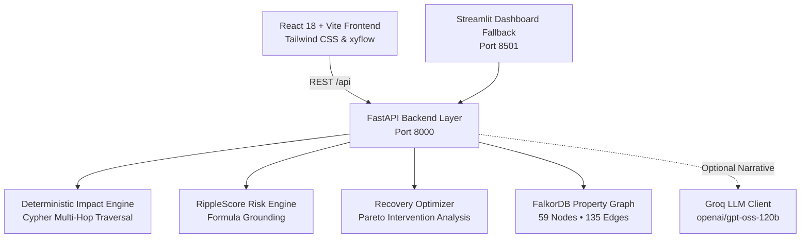

# RippleMap — Municipal Infrastructure Intelligence

> **Deterministic Cascading Dependency Analysis • RippleScore Risk Ranking • Grounded Recovery Optimizer**

RippleMap is an enterprise infrastructure intelligence platform built on **FalkorDB** property graphs, deterministic impact propagation, and explainable multi-sector cascade analysis. It equips municipal dispatchers and emergency managers to simulate infrastructure component failures (e.g. electrical substations, water treatment pumps, telecom spine masts), trace multi-hop failure paths in real-time, compute mathematical vulnerability scores, and evaluate optimal recovery strategies without modifying production infrastructure.

---

## 🏛️ System Architecture



1. **Property Graph Truth (FalkorDB):** 59 infrastructure nodes across 5 critical municipal sectors (Power, Water, Healthcare, Telecom, Transportation) connected by 135 physical dependency relationships (`DRAWS_POWER`, `SUPPLIES_WATER`, `PROVIDES_TELECOM`, `CONNECTS_TO`, `HAS_BACKUP`).
2. **Deterministic Investigation Engine:** Real-time multi-hop graph reachability queries identifying direct and downstream affected assets with exact, verifiable evidence paths.
3. **RippleScore System:** Transparent $[0, 100]$ mathematical vulnerability scoring incorporating inherent facility criticality, reachable downstream services, single-point-of-failure (SPOF) penalties, offset by verified alternate supply routes and standby emergency generators.
4. **Grounded Recovery Decision Studio:** In-memory optimization evaluating candidate interventions (repairs, alternate supply switchovers, generator deployments) with composite benefit scores, restoration windows, residual risk counts, and explicit modeling assumptions:
   - **Layered Incentive Model:** $\text{Score} = (30 \times C_{\text{full}}) + (15 \times C_{\text{part}}) + (10 \times A_{\text{total, full}}) + (5 \times A_{\text{total, part}}) - (3 \times T) - \text{penalties}$
   - **Disjoint Partition Equivalence:** $\text{Score} = (40 \times C_{\text{full}}) + (20 \times C_{\text{part}}) + (10 \times A_{\text{std, full}}) + (5 \times A_{\text{std, part}}) - (3 \times T) - \text{penalties}$
   - *Mathematical Identity:* Since $A_{\text{total}} = C + A_{\text{std}}$, critical services receive 40.0 pts (10 base + 30 priority bonus) while standard assets receive 10.0 pts base (5.0 pts partial). Outage duration is penalized at 3.0 pts/hour. Rankings represent the optimal candidate under the simulation model.
5. **Historical Incident Memory:** Cypher-backed provenance linking current scenarios to prior interventions (`:Incident` and `:RecoveryAction` nodes) with truthful outcome classifications (`RECORDED_SIMULATION_BENCHMARK`, `PROPOSED_ACTION`, `CONFIRMED_SUCCESSFUL`).
6. **Optional Groq LLM Layer:** Natural-language executive synthesis and grounded Q&A using Groq (`openai/gpt-oss-120b`). When unconfigured or unreachable, the system automatically falls back to 100% deterministic graph facts with zero errors.

---

## 🚀 Quickstart Guide

### 1. Prerequisites
- **Python 3.11+**
- **Node.js 18+** & npm
- **Docker** (for FalkorDB container)

### 2. Start FalkorDB
```bash
docker run -p 6379:6379 -it --rm falkordb/falkordb:latest
```

### 3. Backend Setup
```bash
# Create and activate Python virtual environment
python -m venv .venv
# Windows:
.\.venv\Scripts\activate
# Linux/macOS:
source .venv/bin/activate

# Install dependencies
pip install -r requirements.txt

# Configure environment (copy example)
cp .env.example .env

# Seed graph (idempotent, creates 59 nodes and 135 edges)
python -m app.seed

# Launch FastAPI backend
uvicorn app.api:app --host 127.0.0.1 --port 8000
```

### 4. Frontend Setup
```bash
cd frontend
npm install
npm run dev
```
Open **`http://localhost:5173`** in your browser to launch the RippleMap Command Center.

---

## 🧪 Verification & Testing

### Python Test Suite (81 Tests)
Run all integration, graph constraint, scoring identity, recovery ranking, and API tests:
```bash
pytest -v
```

### Production Build & Code Splitting
Verify TypeScript compilation and chunk partitioning:
```bash
cd frontend
npm run build
```
*Vite bundle partitions `@xyflow/react`, `recharts`, and `framer-motion` into clean vendor chunks, maintaining an initial entry bundle of ~60 kB.*

### Automated Browser Acceptance Suite
Drive automated user flows and capture fresh screenshots using headless Google Chrome:
```bash
cd frontend
node qa_runner.cjs
```

---

## 🔒 Safety & Simulation Truthfulness Guarantees
- **Zero Real-World Mutation:** All root failure investigations and recovery optimizer plans run strictly in-memory. Exploring the UI never alters node statuses or writes to graph memory (`persist_memory=False` by default).
- **Truthful Outcome Classifications:** Seeded simulation baselines are explicitly tagged as `RECORDED_SIMULATION_BENCHMARK` with full provenance notes. No simulated outcome is ever presented as a live field recovery.
- **Simulation Model Boundary:** Recovery rankings reflect optimization under stated mathematical model assumptions (crew independence, capacity ratings, and equipment switchgear). They serve as dispatch decision-support triage, not automated real-world operational commands.
- **Credential Protection:** `GROQ_API_KEY` remains strictly server-side in `.env`. No secrets are exposed to client bundles or browser network requests.
