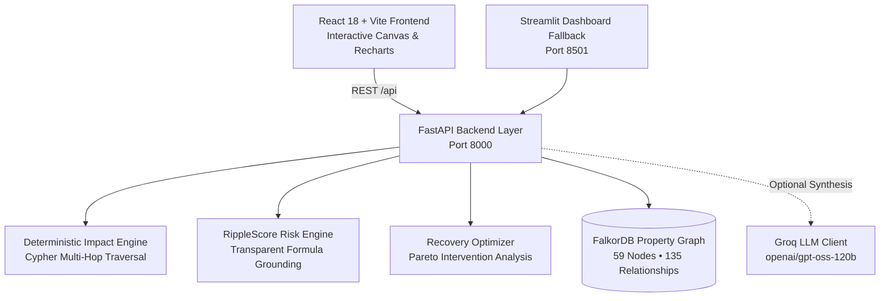
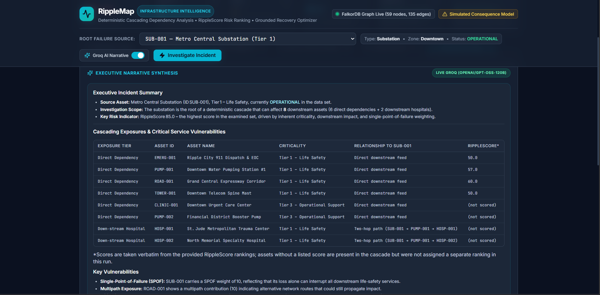
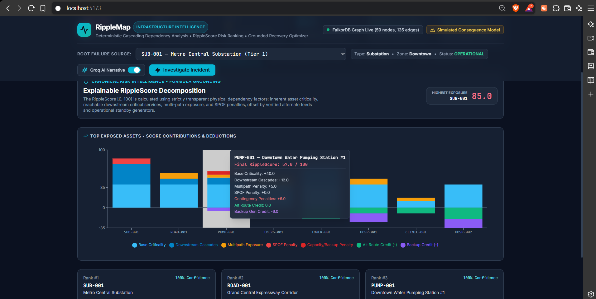
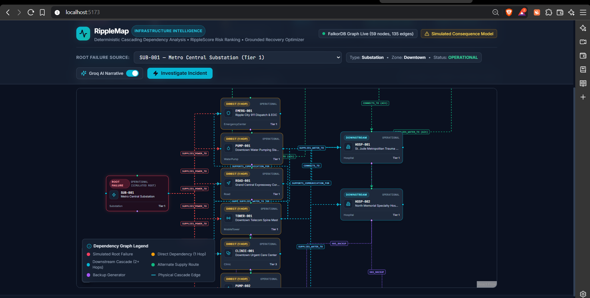
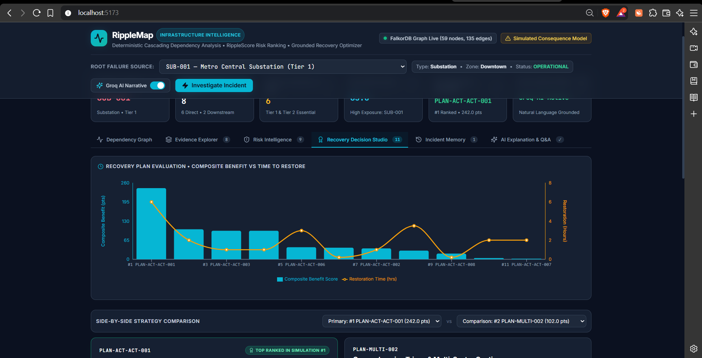
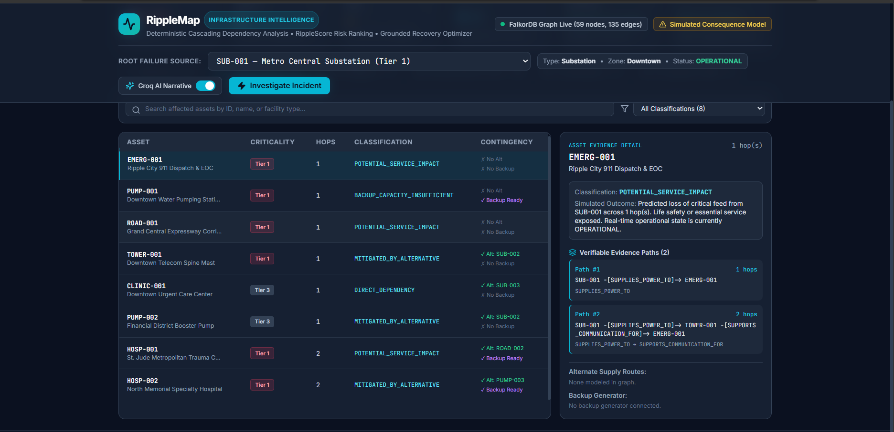
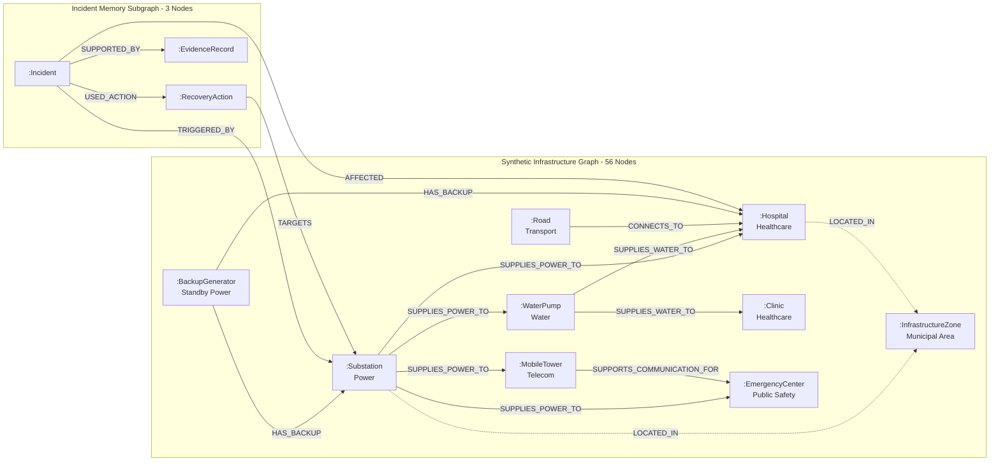

# RippleMap — Municipal Infrastructure Intelligence

> **Deterministic Cascading Dependency Analysis • RippleScore Risk Ranking • Grounded Recovery Optimizer**  
> *Submission for WeMakeDevs × FalkorDB Graph Hacks — Track 01: Agents That Act on Connected Data*

RippleMap is an infrastructure intelligence prototype built natively on **FalkorDB** property graphs, deterministic impact propagation, and explainable multi-sector cascade analysis on synthetic municipal data. It equips simulated dispatchers, utility coordinators, and emergency planners to explore synthetic infrastructure component failures (e.g., electrical substations, water treatment pumps, telecom spine masts), trace multi-hop failure paths in real time, compute transparent mathematical vulnerability scores, and evaluate candidate recovery strategies without modifying graph state.

---

## 📌 Project Overview & Problem Statement

Modern municipal utilities operate as deeply interconnected cyber-physical systems. An electrical substation trip does not stay confined to the power grid:
- It de-energizes water booster stations, starving hospital chiller loops and municipal firefighting pressure.
- It disables cellular spine towers, severing emergency telemetry and field responder dispatch.
- Downstream clinics and transit corridors lose operational viability within minutes.

**The Problem:** Traditional relational databases and tabular asset management software struggle with recursive, variable-length relationship traversals across heterogeneous infrastructure sectors. Performing 3- to 4-hop dependency analysis across municipal systems in SQL requires combinatorial multi-table self-joins that are computationally slow and brittle to schema evolution.

**The Solution:** RippleMap leverages **FalkorDB** to model municipal infrastructure as an interconnected property graph. By querying graph topology directly via Cypher, RippleMap computes cascade blast radiuses, evaluates alternate supply routes, calculates single-point-of-failure (SPOF) risks, and ranks recovery interventions in millisecond-scale query cycles (typically 3–11 ms in local container benchmarks).

---

## ⚡ Why FalkorDB is Central to RippleMap

FalkorDB is not a secondary cache or an afterthought in RippleMap; **it is the authoritative single source of truth for the entire intelligence pipeline**:

1. **Fast Bounded Graph Traversals:** FalkorDB's GraphBLAS sparse matrix linear algebra and in-memory execution engine traverse variable-length physical paths (`*1..4` hops) in single-digit to low double-digit milliseconds (3.3 ms min, 11.0 ms mean in local benchmarks).
2. **Deterministic Impact Propagation:** Rather than relying on non-deterministic LLM reasoning which can hallucinate or omit critical dependencies, cascade blast radiuses are derived mathematically from physical dependency relationships (`SUPPLIES_POWER_TO`, `SUPPLIES_WATER_TO`, `SUPPORTS_COMMUNICATION_FOR`, `CONNECTS_TO`).
3. **Alternate Supply Route Discovery:** Cypher pattern matching instantaneously discovers isolated upstream backup lines and bypass switches, validating whether alternate routes can energize affected assets.
4. **Graph-Backed Incident Memory:** FalkorDB persistently stores simulated incident nodes (`:Incident`), execution logs (`:RecoveryAction`), and structural evidence (`:EvidenceRecord`), allowing autonomous agents to ground recommendations in simulated incident records and benchmark recovery patterns.

---

## 🏛️ System Architecture



### Component Breakdown
1. **FalkorDB Property Graph (Port 6379):** Authoritative topological graph storing 59 nodes and 135 physical/historical relationships.
2. **FastAPI Backend (Port 8000):** High-performance Python backend serving deterministic graph analysis, RippleScore risk computations, recovery optimizations, and grounded LLM synthesis.
3. **React 18 + Vite Frontend (Port 5173):** Production-grade command center built with Tailwind CSS, `@xyflow/react` for interactive dependency graph visualization, and `recharts` for risk trade-off telemetry.
4. **Streamlit Fallback Dashboard (Port 8501):** Alternative zero-configuration administrative UI for pure Python environments.
5. **Optional Groq LLM Layer:** Natural-language executive synthesis using `openai/gpt-oss-120b`. If unconfigured, the system automatically falls back to 100% deterministic graph answers.

---

## Application Screenshots

These screenshots from the running local application demonstrate RippleMap's core operational capabilities, including graph-based dependency analysis, explainable risk ranking, evidence paths, and simulation-based recovery planning evaluated on synthetic municipal infrastructure data:

### Executive Incident Summary


### Explainable RippleScore


### Infrastructure Dependency Graph


### Recovery Decision Studio


### Evidence Explorer


---

## 📊 Graph Data Model & Schema

The Ripple City synthetic municipal infrastructure topology models cross-sector dependencies across **5 critical sectors**: **Power, Water, Healthcare, Telecom, and Transportation**.



### Node Labels
- `:InfrastructureNode` — Base label for all physical and administrative entities (56 nodes total):
  - `:Substation` (6 nodes) — Primary and auxiliary electric distribution hubs (e.g., `SUB-001` rated at 230kV / 450MW).
  - `:WaterPump` (10 nodes) — Potable water pumping and filtration stations.
  - `:MobileTower` (6 nodes) — Cellular voice, 911 dispatch, and municipal radio masts.
  - `:Hospital` (2 nodes) — Tier 1 critical acute-care trauma hospitals.
  - `:Clinic` (6 nodes) — Outpatient, pediatric, and specialized community health centers.
  - `:EmergencyCenter` (5 nodes) — Dispatch centers, fire stations, and emergency operations.
  - `:Road` (9 nodes) — Primary transport corridors, bridges, and access arteries.
  - `:BackupGenerator` (7 nodes) — Standby diesel generators with fuel duration constraints.
  - `:InfrastructureZone` (5 nodes) — Geographic municipal districts (Downtown, North River, Eastside, West Hills, Harbor).
- `:Incident` (1 baseline node) — Simulated failure records and benchmarks.
- `:RecoveryAction` (1 baseline node) — Executed or proposed mitigation procedures.
- `:EvidenceRecord` (1 baseline node) — Modeled multi-hop causal chains.

### Relationship Types (135 Relationships)
- Physical Dependencies:
  - `[:SUPPLIES_POWER_TO]` — Electric power delivery from substations.
  - `[:SUPPLIES_WATER_TO]` — Pressurized water delivery from treatment pumps.
  - `[:SUPPORTS_COMMUNICATION_FOR]` — Telecom telemetry and data services.
  - `[:CONNECTS_TO]` — Road transit links and physical distribution conduits.
  - `[:HAS_BACKUP]` — Dedicated onsite standby emergency generators.
  - `[:DEPENDS_ON]` — General service or physical dependency links.
  - `[:LOCATED_IN]` — Geographic spatial containment in a municipal zone.
- Provenance & Incident Memory:
  - `[:TRIGGERED_BY]` — Links incident to root failure component.
  - `[:AFFECTED]` — Links incident to downstream degraded assets.
  - `[:USED_ACTION]` — Links incident to recovery actions taken.
  - `[:TARGETS]` — Directs recovery action toward target asset.
  - `[:SUPPORTED_BY]` — Attaches modeled multi-hop graph evidence.

---

## 🔍 Real Cypher Queries from Implementation

The following three queries are extracted verbatim from the RippleMap codebase, demonstrating direct agent interaction with connected data:

### 1. Multi-Hop Cascade Traversal (`app/graph_queries.py:138`)
Traverses variable-length directed paths (`*1..4` hops) to compute the cascading blast radius, extracting topological hops and complete causal evidence paths:
```cypher
MATCH p = (src:InfrastructureNode {id: $source_id})-[:SUPPLIES_POWER_TO|SUPPLIES_WATER_TO|SUPPORTS_COMMUNICATION_FOR|CONNECTS_TO*1..4]->(dst:InfrastructureNode)
WHERE src <> dst
RETURN [n in nodes(p) | n.id] AS node_path,
       [n in nodes(p) | n.name] AS name_path,
       [r in relationships(p) | type(r)] AS rel_types,
       length(p) AS hops,
       dst.id AS dest_id, dst.name AS dest_name, dst.entity_type AS dest_type,
       dst.criticality AS dest_criticality, dst.status AS dest_status, dst.zone AS dest_zone
```
- **Parameters:** `$source_id` (e.g. `"SUB-001"`).
- **Agent Usage:** Determines all directly and indirectly compromised infrastructure assets, grouped by hop distance and criticality.

### 2. Alternate Supply Route Discovery (`app/graph_queries.py:189`)
Identifies viable upstream bypass feeds to determine if an affected facility can be re-energized without repairing the primary root failure:
```cypher
MATCH (alt:InfrastructureNode)-[r:SUPPLIES_POWER_TO|SUPPLIES_WATER_TO|SUPPORTS_COMMUNICATION_FOR|CONNECTS_TO]->(dst:InfrastructureNode {id: $target_id})
WHERE NOT alt.id IN $exclusions
RETURN alt.id, alt.name, alt.entity_type, alt.status, type(r) AS rel_type,
       r.dependency_type, r.is_redundant, r.estimated_restoration_hours, r.description
```
- **Parameters:** `$target_id` (e.g. `"TOWER-001"`), `$exclusions` (set of failed or compromised node IDs).
- **Agent Usage:** Evaluates candidate switchover actions and credits redundant infrastructure in the RippleScore formula.

### 3. Historical Incident Memory Retrieval (`app/incident_memory.py:91`)
Retrieves past failure responses, applied recovery actions, and historical evidence linked to the root infrastructure asset:
```cypher
MATCH (inc:Incident)-[:TRIGGERED_BY]->(src:InfrastructureNode {id: $source_id})
OPTIONAL MATCH (inc)-[:AFFECTED]->(aff:InfrastructureNode)
OPTIONAL MATCH (inc)-[:USED_ACTION]->(act:RecoveryAction)
OPTIONAL MATCH (inc)-[:SUPPORTED_BY]->(evd:EvidenceRecord)
RETURN inc.id, inc.title, inc.timestamp, inc.failure_source, inc.severity, inc.simulated, inc.notes,
       collect(DISTINCT aff.id) AS affected_ids,
       act.id, act.action_name, act.action_type, act.status, act.notes,
       evd.path_summary
```
- **Parameters:** `$source_id` (e.g. `"SUB-001"`).
- **Agent Usage:** Grounds recovery recommendations in documented simulation benchmarks, avoiding repeating previously recorded ineffective strategies.

---

## 🧮 RippleScore Formula & Recovery Optimizer

### RippleScore Risk Calculation
RippleScore is a normalized $[0, 100]$ mathematical vulnerability metric evaluated for every affected infrastructure node:
$$\text{RippleScore} = \min\Big(100, \text{Round}\big(\text{Inherent} + \text{DownstreamImpact} + \text{Multipath} + \text{SPOF} - \text{MitigationCredit} - \text{BackupCredit} + \text{Penalties}\big)\Big)$$

- **Inherent Criticality:** Tier 1 (40 pts), Tier 2 (25 pts), Tier 3 (15 pts), Tier 4 (5 pts).
- **Downstream Impact:** Scaled by number and criticality of dependent downstream nodes, attenuated by hop distance: $\sum \frac{\text{CriticalityWeight}(\text{dst})}{\text{HopCount}}$.
- **Single Point of Failure (SPOF) Penalty:** $+10\text{ pts}$ if the asset has zero operational alternate supply lines.
- **Redundancy Offsets:** $-15\text{ pts}$ for active dual-feed utility routing; $-10\text{ pts}$ for operational on-site standby generator.

*Example for Metro Central Substation (`SUB-001`):*
$$\text{Inherent (40)} + \text{DownstreamImpact (35)} + \text{SPOF (10)} - \text{Mitigation (0)} = \mathbf{85.0}\;(\text{High Risk})$$

### Recovery Optimizer Dual-Form Mathematical Identity
The recovery optimizer evaluates candidate action packages (repairs, alternate supply re-routes, emergency generator mobilizations) using a dual-form objective function that balances asset protection against restoration duration:

1. **Layered Incentive Formulation:**
   $$\text{Benefit Score} = (30 \times C_{\text{full}}) + (15 \times C_{\text{part}}) + (10 \times A_{\text{total, full}}) + (5 \times A_{\text{total, part}}) - (3 \times T) - \text{penalties}$$
2. **Disjoint Partition Formulation:**
   $$\text{Benefit Score} = (40 \times C_{\text{full}}) + (20 \times C_{\text{part}}) + (10 \times A_{\text{std, full}}) + (5 \times A_{\text{std, part}}) - (3 \times T) - \text{penalties}$$

- $C_{\text{full}}, C_{\text{part}}$: Critical Tier 1 services fully protected or partially mitigated.
- $A_{\text{total}}$: All protected assets ($A_{\text{total}} = C + A_{\text{std}}$).
- $A_{\text{std}}$: Standard non-critical assets.
- $T$: Total estimated execution hours, penalized at $3.0\text{ pts/hour}$.
- **Mathematical Identity:** Critical services earn a total of 40.0 pts (10 base + 30 priority bonus), while standard assets earn 10.0 pts base. Both formulations yield identical rankings.
- *Benchmark for `PLAN-ACT-ACT-001`:*
  $$\text{Score} = (30 \times 6) + (10 \times 8) - (3 \times 6.0) = 180 + 80 - 18 = \mathbf{242.0}\text{ points (6.0 hrs, 0 residual critical risk)}$$

### Evaluated Recovery Plans for Simulated `SUB-001` Incident
The optimizer generates and compares candidate interventions for the simulated `SUB-001` scenario, clearly distinguishing full restoration from fast interim mitigations:
- **Rank 1 — `PLAN-ACT-ACT-001` (Top Recommendation):**
  - **Score:** 242.0 pts | **Duration:** 6.0 hrs | **Critical Services Protected:** 6 / 6 | **Fully Protected Assets:** 8 (`EMERG-001`, `PUMP-001`, `ROAD-001`, `HOSP-001`, `TOWER-001`, `HOSP-002`, `CLINIC-001`, `PUMP-002`) | **Residual Critical Risk:** 0
  - **Action:** Full hardware repair and re-energization of Metro Central Substation (`ACT-001`).
- **Rank 2 — `PLAN-MULTI-002` (Rapid Multi-Action Interim Mitigation):**
  - **Score:** 102.0 pts | **Duration:** 2.0 hrs | **Critical Services Protected:** 5 | **Fully Protected:** 1 (`TOWER-001`) | **Partially Mitigated:** 4 (`EMERG-001`, `HOSP-001`, `PUMP-001`, `ROAD-001`) | **Residual Critical Risk:** 1 (`HOSP-002`) | **Residual Affected Assets:** 3
  - **Actions:** Parallel dispatch combining auxiliary telecom re-route (`ACT-003`), emergency transit corridor (`ACT-002`), St. Jude generator (`ACT-008`), and water pump APU (`ACT-007`).
- **Rank 3 — `PLAN-ACT-ACT-003` (Rapid Telecom Auxiliary Tie-Line):**
  - **Score:** 97.0 pts | **Duration:** 1.0 hr | **Critical Services Protected:** 4 | **Fully Protected:** 1 (`TOWER-001`) | **Partially Mitigated:** 3 | **Residual Critical Risk:** 2 | **Residual Affected Assets:** 4
  - **Action:** Energize alternate power feed from North River Substation (`SUB-002`) to Downtown Telecom Spine (`ACT-003`).

### Explicit Optimizer Modeling Assumptions
- **Model-Based Optimization Estimates:** Recovery rankings and benefit scores reflect optimization under mathematical modeling assumptions rather than real-world operational guarantees.
- **Independent Crew Parallelism:** Simultaneous actions assume non-interfering utility crews (e.g., electrical lineworkers operating independently from generator mechanics).
- **Linear Duration Scaling:** Execution windows represent engineering estimates under standard operational conditions.
- **Headroom Verification Required:** Switchovers to alternate substations or water mains assume capacity headroom that must be verified by field engineers prior to energization.

---

## 🔌 API Endpoints (FastAPI)

RippleMap provides clean RESTful JSON endpoints on `http://127.0.0.1:8000`:

| Method | Endpoint | Description |
|---|---|---|
| `GET` | `/api/health` | Verifies FalkorDB connectivity, node count (59), and relationship count (135). |
| `GET` | `/api/sources` | Lists all selectable physical infrastructure root failure candidates. |
| `GET` | `/api/investigate?source_id={id}&use_llm={bool}` | Executes deterministic cascade analysis, evidence collection, and recovery optimization. |
| `POST` | `/api/investigate` | JSON body execution of cascade investigation with optional question synthesis. |
| `POST` | `/api/ask` | Evaluates evidence-grounded operational questions with Groq synthesis or deterministic fallback. |

---

## 🚀 Local Quickstart Guide

RippleMap is fully reproducible locally with **₹0 hosting budget** using Docker, Python, and Node.js.

### 1. Prerequisites
- **Docker Desktop** (or Docker Engine)
- **Python 3.11+**
- **Node.js 18+** & npm

### 2. Start FalkorDB
Launch the official FalkorDB image:
```bash
docker run -p 6379:6379 -it --rm falkordb/falkordb:latest
```

### 3. Backend Setup
```bash
# Clone the repository
git clone https://github.com/MADHANKUMAR98/Ripplemap.git
cd Ripplemap

# Create and activate Python virtual environment
python -m venv .venv
# Windows:
.\.venv\Scripts\activate
# Linux/macOS:
source .venv/bin/activate

# Install dependencies
pip install -r requirements.txt

# Configure environment (copy example)
cp .env.example .env

# Seed the graph (idempotent Cypher MERGE; creates 59 nodes and 135 edges)
python -m app.seed

# Start FastAPI backend
uvicorn app.api:app --host 127.0.0.1 --port 8000
```

### 4. Frontend Setup
In a new terminal window:
```bash
cd frontend
npm install
npm run dev
```
Open **`http://localhost:5173`** in your browser to access the RippleMap Command Center.

### 5. Streamlit Fallback Dashboard (Optional)
If running in a lightweight Python-only environment:
```bash
streamlit run streamlit_app.py --server.headless true --server.port 8501
```
Open **`http://localhost:8501`** for the interactive Streamlit dashboard.

---

## 🧪 Verification & Testing Suite

### 1. Python Integration Suite (82 Tests)
Run all 82 automated tests covering graph connectivity, schema constraints, multi-hop reachability, SPOF detection, RippleScore formulas, optimizer dual-form identities, and zero-mutation safety:
```bash
pytest -v
```
*Result: 82 passed in ~11 seconds.*

### 2. Frontend Typecheck & Production Build
Verify TypeScript typing and Vite production bundling:
```bash
cd frontend
npm run build
```
*Output: TypeScript compilation 0 errors; code-split vendor chunks created in `frontend/dist/` (initial entry ~62 kB).*

### 3. Automated Browser Acceptance Suite
Drive full end-to-end user flows and capture fresh screenshots using headless Google Chrome:
```bash
cd frontend
node qa_runner.cjs
```

---

## 🔒 Simulation Disclaimers & Safety Guarantees

- **Prototype & Synthetic Data Scope:** RippleMap is a research and decision-support prototype evaluated on synthetic municipal topology. It does not perform live telemetry ingestion, real-world outage detection, or guaranteed optimal field dispatch.
- **Zero Database Mutation During Investigation:** Exploring incidents or testing recovery plans in the UI never mutates node operational statuses or graph structure (`persist_memory=False` by default).
- **Truthful Outcome Classifications:** Historical baseline incidents are explicitly tagged as `RECORDED_SIMULATION_BENCHMARK`. No simulated recovery plan is ever presented as a confirmed real-world field outcome.
- **Human-in-the-Loop Requirement:** RippleMap is an operational decision-support tool. Recommended recovery actions must be reviewed and authorized by licensed utility dispatchers and qualified field engineers before executing physical switchgear or valve modifications.
- **Server-Side Credential Protection:** All API keys (`GROQ_API_KEY`) remain strictly server-side in `.env` and are never exposed in client bundles or network responses.

---

## 🤖 AI-Assisted Development Disclosure

- **Development Acceleration:** RippleMap was conceptualized, architected, and built with pair-programming assistance from the **Google Antigravity AI IDE**, utilizing agentic workflows for automated testing, schema verification, and UI integration.
- **Runtime Agent Explanation Layer:** Runtime narrative synthesis and grounded question-answering optionally utilize Groq (`openai/gpt-oss-120b`). When Groq is not configured or offline, RippleMap operates via 100% deterministic graph logic. Grounded LLM explanations are advisory and non-authoritative; operators must verify critical decisions against the primary Cypher graph traversals and mathematical formulas.

---

## 🎬 Submission Artifacts & Links

- **Public GitHub Repository:** [https://github.com/MADHANKUMAR98/Ripplemap](https://github.com/MADHANKUMAR98/Ripplemap)
- **Hackathon Track:** WeMakeDevs × FalkorDB Graph Hacks — Track 01: Agents That Act on Connected Data
- **Demo Video:** [Google Drive Video Walkthrough](https://drive.google.com/file/d/1NpDFxcTiAtzh_4fR6NKOCGgT2g-l0WGl/view?usp=sharing)
- **Live Deployment:** None provided (Local execution recommended). Per Hackathon guidelines and zero-cost hosting constraints, RippleMap is fully reproducible locally using the provided Docker (FalkorDB), FastAPI backend, and React/Vite frontend setup. No external cloud deployment is hosted.

